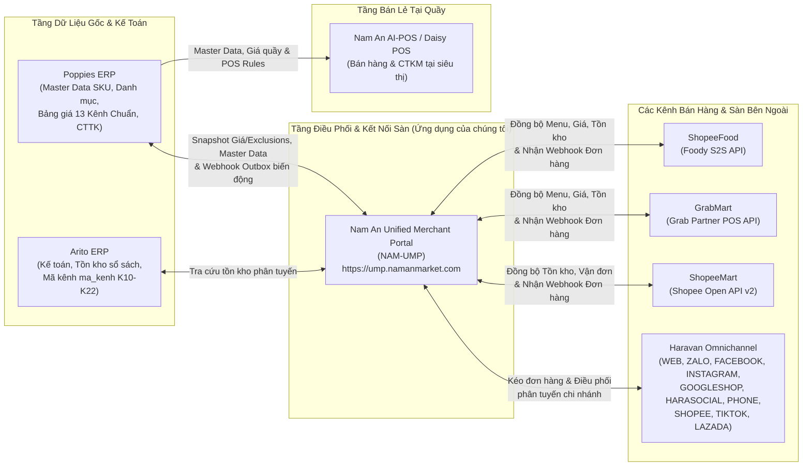

# 📘 TÀI LIỆU GIỚI THIỆU HỆ THỐNG & PHỐI HỢP TÍCH HỢP
## Nam An Unified Merchant Portal (NAM-UMP) $\longleftrightarrow$ Poppies ERP

- **Tài liệu dành cho:** Đội ngũ Phát triển **Poppies ERP** (Quản trị Master Data Hàng hóa, Danh mục & Giá đa kênh)
- **Từ đội ngũ:** **Nam An Unified Merchant Portal (NAM-UMP)**
- **Môi trường Production NAM-UMP:** `https://ump.namanmarket.com`
- **Cập nhật lần cuối:** `06/11/2026` *(Đã chuẩn hóa 100% theo `INTEGRATION_REPORT_FOR_AI_POS_AND_UMP`)*

---

## 1. Giới Thiệu Chung: NAM-UMP Là Gì?

**Nam An Unified Merchant Portal (NAM-UMP)** là **Cổng Quản Trị Đơn Hàng Đa Kênh & Kết Nối Sàn Thương Mại Điện Tử Hợp Nhất** của chuỗi siêu thị Nam An Market.

Nếu **Poppies ERP** đóng vai trò là **"Bộ não Dữ liệu gốc (Master Data & Pricing Brain)"** — nơi quản trị toàn bộ danh mục hàng hóa, thông tin SKU, quy cách, trạng thái kinh doanh và chính sách giá bán trên từng kênh — thì **NAM-UMP** đóng vai trò là **"Cánh tay Thực thi Đa kênh & Điều phối Vận hành (Omnichannel Execution & Marketplace Hub)"**.

### 🎯 Định vị rõ ràng để tránh chồng chéo nghiệp vụ:
- **NAM-UMP KHÔNG phải là phần mềm POS thu ngân tại quầy** (không xử lý thanh toán trực tiếp tại quầy, CTKM `pos-rules` / `time_slots` hay in hóa đơn nhiệt 80mm — nghiệp vụ đó thuộc về hệ thống **Nam An AI-POS / Daisy POS**).
- **NAM-UMP KHÔNG phải là hệ thống quản trị Master Data gốc hay Thu mua** (không quản lý giá vốn, chiết khấu nhà cung cấp, hợp đồng mua hàng hay công thức tính giá gốc — nghiệp vụ đó thuộc độc quyền của **Poppies ERP**).
- **NAM-UMP LÀ trung tâm vận hành Online & cầu nối kỹ thuật ra các Sàn bên ngoài**: Tiếp nhận dữ liệu chuẩn từ Poppies ERP để đẩy (sync) ra các nền tảng giao hàng/TMĐT, đồng thời gom toàn bộ đơn hàng Online từ mọi kênh về một giao diện duy nhất để Tổng đài và các Chi nhánh siêu thị xử lý.

---

## 2. Vị Trí & Ranh Giới Trách Nhiệm Trong Hệ Sinh Thái Nam An Market



### Bảng Phân Định Ranh Giới Giữa Poppies ERP và NAM-UMP

| Mảng nghiệp vụ | Trách nhiệm của **Poppies ERP** | Trách nhiệm của **NAM-UMP (Merchant Portal)** |
| :--- | :--- | :--- |
| **Danh mục & Hồ sơ SKU** | **Single Source of Truth (SSOT)**: Khởi tạo mã SKU, Barcode, tên chuẩn, ĐVT, ngành hàng, hạn sử dụng, quy cách, trạng thái TTHH (`01` Kinh doanh, `02` Khóa) và khóa riêng chi nhánh (`khoaRieng`). | **Consumer & Mapper**: Đồng bộ danh mục SKU từ Poppies ERP về; ánh xạ (map) SKU nội bộ sang mã món/sản phẩm riêng của từng sàn (`dish_id` ShopeeFood, `item_id` GrabMart, `item_id` Shopee). |
| **Quản trị Giá 13 Kênh & Kế thừa Giá Quầy** | **SSOT về Giá**: Quản lý giá quầy `STORE` và bảng giá riêng các kênh đối tác (`has_partner_pricing = True`: `GRAB`, `SHOPEEFOOD`, `SHOPEE`, `TIKTOK`, `LAZADA`), đồng thời cho phép các kênh Social/Web kế thừa giá `STORE` (`has_partner_pricing = False`, `inherited_from = "STORE"`). | **Channel Publisher (Fail-Closed)**: Đồng bộ Snapshot giá & danh sách cấm bán (`exclusions` / `blocked_skus`) từ Poppies ERP; tự động kế thừa giá gốc `STORE` cho các kênh `has_partner_pricing = False` mà không nhân bản 92.000 dòng giá; đẩy giá hiệu lực lên sàn. |
| **Bật / Tắt bán SKU theo kênh** | Quản trị trạng thái kênh Canonical (`is_active`), danh sách cấm bán trên từng kênh (`exclusions` / `isPublished = False`) và phát sự kiện Outbox khi thay đổi. | Thực thi đóng/mở món trên sàn, tôn trọng tuyệt đối quyền tối cao của kênh Canonical (kênh Canonical đóng `is_active = False` sẽ khóa toàn bộ SKU bất kể alias cũ). Hỗ trợ Cửa hàng trưởng Tắt/Bật nhanh 1-chạm và đồng bộ ngược về Poppies ERP. |
| **Tồn kho bán hàng Online** | Cung cấp dữ liệu tồn kho tức thời đa chi nhánh (`inventoryCttk` / `slTon` theo kho, lô, vị trí) và mức trưng bày tối thiểu (`minDisplay`). | Áp dụng tồn kho khả dụng + `safety_stock` theo từng chi nhánh (`10001`, `10004`, `10005`, `10006`) để đẩy số lượng tồn lên sàn và hỗ trợ Tổng đài chọn siêu thị đủ hàng khi phân tuyến đơn. |
| **Xử lý Đơn hàng Online** | *Không xử lý vận hành đơn hàng sàn.* | **Trách nhiệm chính**: Nhận đơn real-time từ mọi sàn & Haravan, phân tuyến về chi nhánh, điều phối nhân viên siêu thị gom hàng $\rightarrow$ đóng gói $\rightarrow$ giao tài xế / gửi vận đơn $\rightarrow$ hoàn tất. |

---

## 3. Các Nhiệm Vụ Cụ Thể Của NAM-UMP

### 3.1. Quản Trị & Điều Phối Đơn Hàng Đa Kênh Tập Trung (Core Order Operations)
NAM-UMP gom toàn bộ đơn hàng trực tuyến về một màn hình điều hành duy nhất cho Tổng đài (Dispatcher) và Nhân viên siêu thị (Store Staff), chia làm 2 luồng vận hành rõ rệt:

1. **Luồng Đơn Giao Nhanh Trên App Sàn (`SHOPEEFOOD`, `GRAB`, `SHOPEE`):**
   - Khách đặt trực tiếp trên ứng dụng sàn theo định vị GPS $\rightarrow$ Sàn bắn Webhook đơn mới về NAM-UMP kèm mã định danh cửa hàng.
   - NAM-UMP tự động map về đúng chi nhánh siêu thị (`10001` Thảo Điền, `10004` Quận 7, `10005` Mai Chí Thọ, `10006` Nguyễn Văn Trỗi) **không cần phân tuyến thủ công**.
   - Nhân viên chi nhánh nhận chuông báo đơn mới, bấm **Xác nhận $\rightarrow$ Soạn hàng / Báo xong $\rightarrow$ Giao tài xế**, hệ thống tự động gọi API cập nhật trạng thái ngược lại sàn.
2. **Luồng Đơn Đa Kênh Haravan Omnichannel (`WEB`, `ZALO`, `FACEBOOK`, `INSTAGRAM`, `GOOGLESHOP`, `HARASOCIAL`, `PHONE`, `SHOPEE`, `LAZADA`, `TIKTOK`):**
   - Đơn hàng mới đổ về trung tâm chưa gắn chi nhánh (`assigned_store = null`).
   - **Tổng đài Điều phối** mở đơn trên NAM-UMP, đối chiếu tồn kho thực tế giữa các chi nhánh và bấm **Phân tuyến** về siêu thị tối ưu nhất (gần khách nhất & đủ tồn kho nhất).
   - **Nhân viên Chi nhánh** chỉ nhìn thấy đơn hàng đã được phân về đúng cửa hàng mình (cô lập quyền hạn RBAC theo `store_code`), thực hiện **Đóng gói $\rightarrow$ Gửi vận đơn $\rightarrow$ Hoàn tất**. Trường hợp kệ thực tế thiếu hàng, chi nhánh bấm **Yêu cầu phân tuyến lại** để trả đơn về Tổng đài điều chuyển sang siêu thị khác.

### 3.2. Đồng Bộ Master Data, Snapshot Giá Kênh (Fail-Closed) & Menu Lên Các Sàn
NAM-UMP đóng vai trò **Lớp Phiên Dịch (Adapter Layer)** tuân thủ nghiêm ngặt kiến trúc của Poppies ERP:
- **Cơ chế Fail-Closed (An toàn tuyệt đối khi đứt kết nối):** Khi kéo Pricing Snapshot từ Poppies ERP, nếu gặp lỗi mạng hoặc HTTP `5xx` / Timeout, NAM-UMP **tuyệt đối không ghi đè rỗng danh sách cấm bán (`blocked_skus`)** mà giữ nguyên **Last-Known-Good Cache** hiện tại để không bao giờ vô tình mở bán nhầm hàng cấm/hàng lỗi giá lên sàn.
- **Kế thừa Giá Quầy (`STORE` Inheritance) & Bảo toàn Cấm bán (`Exclusions`):** Với các kênh `has_partner_pricing = False` (`WEB`, `ZALO`, `FACEBOOK`, `INSTAGRAM`, `GOOGLESHOP`, `HARASOCIAL`, `PHONE`), NAM-UMP tự động lấy giá gốc `STORE` nhưng vẫn thực thi 100% danh sách SKU bị cấm bán riêng trên từng kênh đó.

### 3.3. Kiểm Soát Tồn Kho Đa Chi Nhánh & Chống Hủy Đơn Phạt Từ Sàn
- Kéo tồn kho tức thời CTTK từ Poppies ERP cho từng chi nhánh vật lý (`10001`, `10004`, `10005`, `10006`), tự động khóa bán tại chi nhánh nếu mặt hàng bị đánh dấu `tthh.khoaRieng[store_code] = true` hoặc `status != "01"`.
- Cung cấp công cụ **Bật / Tắt món tức thì (1-Click In-Stock / Out-of-Stock)** theo từng siêu thị để nhân viên cửa hàng ngưng nhận đơn ngay khi hàng tươi sống (`isFresh`) vừa hết trên kệ.

### 3.4. Giám Sát Sức Khỏe Kết Nối & Đối Soát Lịch Sử (Audit & System Health)
- Lưu trữ toàn bộ nhật ký Webhook nhận từ các sàn/Poppies (`WebhookAuditLog`) đảm bảo chống xử lý trùng (`Idempotency`) và chống ghi đè ngược thứ tự thời gian (`Out-of-Order Protection`), kèm lịch sử đồng bộ (`SyncLog`) và cảnh báo tập trung (`/system-status`).

---

## 4. Cơ Chế Tích Hợp Kỹ Thuật Giữa Poppies ERP & NAM-UMP

**NAM-UMP đã nâng cấp hoàn chỉnh bộ dịch vụ `PoppiesClient`, `PoppiesPricingGovernanceMixin` & `PoppiesOutboxWebhookMixin`** khớp 100% đặc tả kỹ thuật của Poppies ERP:

### 4.1. Chiều 1: NAM-UMP Gọi Sang API Của Poppies ERP (Pull & Sync)
NAM-UMP đóng vai trò Client gọi sang Gateway của Poppies ERP (xác thực bằng header `X-POS-API-Key`):

| STT | Endpoint bên Poppies ERP | Mục đích NAM-UMP sử dụng |
| :---: | :--- | :--- |
| 1 | `GET /api/v1/pos/master-data/health` | Kiểm tra trạng thái kết nối tới Poppies ERP, độ trễ DB và tổng số bản ghi SKU / CTTK. |
| 2 | `GET /api/v1/pos/master-data/snapshot` | Đồng bộ phân trang danh mục ngành hàng, thông tin SKU, Barcode, ảnh `ecommerce.imageUrl`, giá gốc VAT, cờ `tthh.khoaRieng` và tồn kho `inventoryCttk`. |
| 3 | `GET /api/v1/pos/master-data/sku/{sku_or_barcode}` | Tra cứu tức thời thông tin chi tiết & quyền mở bán của 1 SKU cụ thể theo `branch_code`. |
| 4 | `GET /api/v1/pos/master-data/cttk-records` | Đồng bộ nhanh (Fast Sync) số lượng tồn kho tức thời `slTon` của các SKU trên toàn bộ chi nhánh. |
| 5 | `GET /api/v1/pos/pricing/channels` | Lấy danh sách **13 kênh Canonical** kèm trạng thái `is_active`, `has_partner_pricing`, `inherited_from`, `aliases` và mã kênh kế toán Arito (`ma_kenh`). |
| 6 | `GET /api/v1/pos/pricing/snapshots` | Đồng bộ bảng giá kênh & danh sách cấm bán (`exclusions` / `blocked_skus`) theo định dạng `map` hoặc `list` (hỗ trợ delta `since_version`, cơ chế **Fail-Closed**). |
| 7 | `POST /api/v1/pricing/channel-publish-status` | Khi Quản lý thao tác Bật/Tắt bán 1 SKU trên 1 kênh từ NAM-UMP, NAM-UMP đẩy mã kênh chuẩn Canonical (`scopeCode`) về đồng bộ ngay với Poppies ERP. |

### 4.2. Chiều 2: Poppies ERP Bắn Webhook Sang NAM-UMP (Real-Time Outbox Push)
Khi người dùng trên Poppies ERP thay đổi **Giá bán theo kênh**, **Cấu hình chính sách kênh** hoặc **Bật/Tắt bán sản phẩm trên kênh**, `PricingOutboxDispatcher` của Poppies ERP bắn thẳng Webhook sang NAM-UMP:

- **Webhook URL đích (Production NAM-UMP):**
  ```http
  POST https://ump.namanmarket.com/api/v1/pricing/webhook/price-changed
  ```
- **Headers hỗ trợ:**
  - `Content-Type: application/json`
  - `X-Poppies-Webhook-Key: <SHARED_SECRET_KEY>` *(khóa bí mật thống nhất giữa 2 team)*
  - `X-Event-Id: <event_id>` *(hoặc `Idempotency-Key` — chống xử lý trùng lặp qua `WebhookAuditLog`)*
- **Các loại sự kiện (`event_type`) NAM-UMP hỗ trợ đầy đủ:**
  1. `CHANNEL_PUBLISH_STATUS_CHANGED`: Bật/tắt bán SKU trên kênh (`is_published: true/false`).
  2. `CHANNEL_PRICING_STATUS_CHANGED`: Thay đổi trạng thái đóng/mở kênh (`is_active`) hoặc chính sách giá riêng (`has_partner_pricing`).
  3. `price_changed`: Biến động giá bán hiệu lực của SKU trên kênh (giữ nguyên an toàn trạng thái mở bán hiện hành của SKU, bảo vệ thứ tự thời gian qua `timestamp`).
- **Payload JSON mẫu:**
  ```json
  {
    "event_id": "evt_outbox_89412a87c3b1",
    "event": "price_changed",
    "event_type": "CHANNEL_PUBLISH_STATUS_CHANGED",
    "channel_code": "GRAB",
    "branch_code": "ALL",
    "affected_skus": ["290031798000"],
    "is_published": false,
    "is_full_catalog": false,
    "timestamp": "2026-11-06T04:00:00Z"
  }
  ```

---

## 5. Quy Ước Mã Định Danh Dùng Chung (Shared Identifiers)

Để dữ liệu giữa **Poppies ERP**, **NAM-UMP**, **Nam An AI-POS** và **Arito ERP** khớp tuyệt đối 100%, NAM-UMP chuẩn hóa theo đúng **14 Kênh Canonical** trên Production Poppies ERP (`GET /api/v1/pos/pricing/channels`) kèm bộ phân giải Alias tương thích ngược:

### 5.1. Định danh Hàng hóa & Chi nhánh
- **Khóa chính đối chiếu hàng hóa:** `skuCode` (ví dụ: `290030839000`) — dùng xuyên suốt để map sản phẩm, bảng giá kênh, tồn kho và dòng chi tiết đơn hàng (`line_items[].sku`).
- **Mã chi nhánh siêu thị (`store_code` / `branch_code`):**
  - `10001`: Nam An Market Thảo Điền
  - `10004`: Nam An Market Quận 7 (Phú Mỹ Hưng)
  - `10005`: Nam An Market Mai Chí Thọ
  - `10006`: Nam An Market Nguyễn Văn Trỗi
  - `20004`: Kho Tổng Trung Tâm

### 5.2. Bảng 14 Mã Kênh Bán Hàng Chuẩn Hóa (`Canonical Channel Codes`)

| STT | Mã Chuẩn (`channel_code`) | Alias Tương Thích Ngược | Mã Kênh Arito (`ma_kenh`) | Chính Sách Giá | Vai Trò Xử Lý Trên NAM-UMP |
| :-: | :--- | :--- | :---: | :--- | :--- |
| 1 | `STORE` | `POS_OFFLINE`, `OFFLINE`, `STORE_POS`, `TAI_QUAY` | `K21` | Giá gốc quầy | Mốc giá gốc tham chiếu cho các kênh kế thừa (`inherited_from = "STORE"`). |
| 2 | `SHOPEE` | `SHOPEE_MALL` | `K20` | Giá đối tác riêng | Shopee Mall Nam An — Tiếp nhận & Điều phối phân tuyến đơn hàng qua Haravan Omnichannel. |
| 3 | `SHOPEEMART` | `SHOPEE_MART`, `SHOPEE_FRESH` | `K12` | Giá đối tác riêng | **ShopeeMart** — Tự động đồng bộ Tồn kho / Bật-Tắt món / AWB trực tiếp qua Shopee Open API v2 (`ShopeeMartChannelAdapter`). |
| 4 | `TIKTOK` | `TIKTOK_SHOP`, `TIKTOKSHOP`, `TTS` | `K17` | Giá đối tác riêng | Tiếp nhận & Điều phối phân tuyến đơn hàng qua Haravan Omnichannel. |
| 5 | `LAZADA` | `LAZADA_MALL` | `K20` | Giá đối tác riêng | Tiếp nhận & Điều phối phân tuyến đơn hàng qua Haravan Omnichannel. |
| 6 | `GRAB` | `GRAB_MART`, `GRABMART` | `K15` | Giá đối tác riêng | **GrabMart Express** — Tự động đồng bộ Menu, Giá, Tồn kho / Bật-Tắt món & Nhận đơn trực tiếp qua `GrabMartChannelAdapter`. |
| 7 | `SHOPEEFOOD` | `SHOPEE_FOOD`, `NOW_VN` | `K22` | Giá đối tác riêng | **ShopeeFood / Now** — Tự động đồng bộ Menu, Giá, Tồn kho / Bật-Tắt món & Nhận đơn trực tiếp qua `ShopeeFoodChannelAdapter`. |
| 8 | `WEB` | `HARAVAN_WEB`, `HARAVAN`, `WEBSITE`, `NAMANMARKET_VN` | `K20` | Giá đối tác riêng | Tiếp nhận & Phân tuyến đơn đặt từ Website `namanmarket.com`. |
| 9 | `ZALO` | `ZALO_OA`, `ZALO_MINI_APP`, `ZALO_APP` | `K20` | Kế thừa `STORE` | Tiếp nhận & Phân tuyến đơn đặt từ Zalo OA / Zalo Mini App. |
| 10 | `FACEBOOK` | `FB`, `FB_SHOP` | `K20` | Kế thừa `STORE` | Tiếp nhận & Phân tuyến đơn đặt từ Facebook Fanpage / Messenger. |
| 11 | `INSTAGRAM` | `IG`, `IG_SHOP` | `K20` | Kế thừa `STORE` | Tiếp nhận & Phân tuyến đơn đặt từ Instagram Direct. |
| 12 | `GOOGLESHOP` | `GOOGLE_SHOP`, `GG_SHOP`, `GOOGLE` | `K20` | Kế thừa `STORE` | Tiếp nhận & Phân tuyến đơn đặt từ Google Shopping. |
| 13 | `HARASOCIAL` | `HARA_SOCIAL`, `HARASOCIAL_CHAT` | `K20` | Kế thừa `STORE` | Tiếp nhận & Phân tuyến đơn đặt từ hội thoại HaraSocial. |
| 14 | `PHONE` | `HOTLINE`, `TEL` | `K20` | Kế thừa `STORE` | Tiếp nhận & Phân tuyến đơn đặt qua Tổng đài Hotline / Telesale. |

---

## 6. Thông Tin Kỹ Thuật Hệ Thống NAM-UMP & Đề Xuất Phối Hợp

### Thông tin kỹ thuật nhanh của NAM-UMP:
- **Backend:** Python 3.12, FastAPI (Async ASGI), SQLAlchemy 2.0, Pydantic v2.
- **Database:** PostgreSQL (Core Catalog, 13-Channel Pricing & Exclusions Cache, Multi-Store Inventory, Platform Orders, RBAC) & MongoDB (Haravan Omnichannel Orders & Dispatch History).
- **Tài liệu Swagger / OpenAPI trực tuyến:** `https://ump.namanmarket.com/docs`
- **Health Check Endpoint:** `https://ump.namanmarket.com/api/v1/health`

### Các điểm sẵn sàng phối hợp cùng Dev Team Poppies ERP:
1. **Kích hoạt Outbox Webhook sang NAM-UMP:** Nhờ team Poppies đăng ký URL `https://ump.namanmarket.com/api/v1/pricing/webhook/price-changed` vào cấu hình đích của `PricingOutboxDispatcher` và đối chiếu khóa `X-Poppies-Webhook-Key` trên môi trường Production.
2. **Đồng bộ Snapshot định kỳ & Delta Sync:** NAM-UMP đã mở endpoint quản trị `POST /api/v1/pricing/snapshots/sync` kết nối trực tiếp vào `GET /api/v1/pos/pricing/snapshots` của Poppies ERP (hỗ trợ cả `format=map` và `format=list` cùng `since_version`).
3. **Thông báo trước khi thay đổi Schema:** Nếu có bổ sung trường mới trong `pricing/snapshots`, `tthh.khoaRieng`, `inventoryCttk` hoặc `ecommerce`, hai team sẽ trao đổi trước để cập nhật schema tương ứng.
