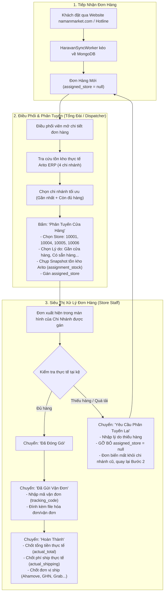

# Hướng Dẫn Quy Trình Phân Tuyến & Vòng Đời Đơn Hàng (Order Dispatch & Lifecycle Guide)

> **Tài liệu quy định nghiệp vụ cốt lõi:** Phân biệt rõ ràng giữa **Đơn hàng Haravan Omnichannel (Cần phân tuyến)** và **Đơn hàng từ Platform (Tự động phân bổ, không cần phân tuyến)**.

---

## 1. Nguyên Tắc Cốt Lõi Về Phân Tuyến Đơn Hàng

| Tiêu chí | Đơn từ Platform (ShopeeFood, GrabMart, ShopeeMart) | Đơn từ Haravan Omnichannel (Website, Hotline, Shopee/Lazada via Haravan) |
| :--- | :--- | :--- |
| **Bản chất kênh** | Kênh giao hàng hỏa tốc / theo app địa lý của sàn thương mại điện tử. | Kênh bán hàng tổng thể đa kênh của thương hiệu Nam An Market. |
| **Xác định chi nhánh** | **ĐÃ XÁC ĐỊNH SẴN TỪ PLATFORM.**<br>Khách hàng khi đặt app đã chọn đích danh cửa hàng (hoặc app sàn định vị GPS tới cửa hàng gần nhất). Webhook gửi về kèm mã định danh cửa hàng (`partner_store_id`, `shop_id`). | **CHƯA XÁC ĐỊNH CHI NHÁNH.**<br>Khách đặt trên website chung `namanmarket.com` hoặc qua hotline. Đơn đổ về Haravan Hub trung tâm mà chưa biết siêu thị nào sẽ xử lý và giao hàng. |
| **Yêu cầu Phân tuyến** | ❌ **KHÔNG CẦN PHÂN TUYẾN THỦ CÔNG.**<br>Hệ thống UMP tự động map qua `StoreChannelMapping` gán thẳng vào `Store.id` / `Store.code`. Đơn hàng chuyển thẳng sang trạng thái sẵn sàng chuẩn bị hàng. | ⚡ **BẮT BUỘC PHẢI PHÂN TUYẾN (DISPATCH REQUIRED).**<br>Điều phối viên tổng đài phải mở đơn, tra cứu tồn kho Arito ERP 4 chi nhánh và bấm nút **"Phân Tuyến Cửa Hàng"**. |
| **Nhân viên chi nhánh thấy đơn khi nào?** | Thấy **ngay lập tức** khi sàn bắn Webhook về. | **Chỉ thấy sau khi Điều phối viên đã phân tuyến** về đúng mã chi nhánh của mình (`assigned_store`). |

---

## 2. Quy Trình Chi Tiết Đối Với Đơn Haravan Omnichannel



---

## 3. Quy Trình Đối Với Đơn Platform (ShopeeFood, GrabMart, ShopeeMart)

1. **Tiếp nhận tự động qua Webhook:**
   - ShopeeFood gửi đơn $\rightarrow$ UMP tự động map `store_code = 10001` (Thảo Điền).
   - GrabMart gửi đơn $\rightarrow$ UMP tự động map `store_code = 10004` (Phú Mỹ Hưng).
   - ShopeeMart gửi đơn $\rightarrow$ Outlet Shop ID tương ứng.
2. **Không qua bước phân tuyến:**
   - Đơn hàng đi thẳng vào quy trình xử lý của siêu thị: `ACCEPTED` / `READY_TO_SHIP` / `PICKED_UP` / `DELIVERED`.
   - Nhân viên chi nhánh tiếp nhận và bấm xác nhận / đóng gói ngay cho tài xế của sàn đến lấy.

---

## 4. Cấu Trúc Dữ Liệu `internal` Cho Đơn Phân Tuyến

Đối với các đơn hàng Haravan, toàn bộ thông tin phân tuyến và lịch sử xử lý được lưu trữ trong object `internal` bên trong MongoDB:

```json
{
  "order_number": "#NA229001",
  "source": "checkout_next",
  "total_price": 385000,
  "internal": {
    "order_processing_status": "Đã phân tuyến",
    "assigned_store": "10001",
    "assignment_reason": "Gần cửa hàng",
    "assignment_note": "Giao trước 11h trưa",
    "assigned_by": "admin",
    "assigned_at": "2026-10-12T04:45:00Z",
    "assignment_stock": {
      "001020": { "10001": 5.0, "10004": 2.0, "10005": 0.0, "10006": 1.0 }
    },
    "history": [
      {
        "timestamp": "2026-10-12T04:40:00Z",
        "action": "Đồng bộ đơn hàng từ Haravan",
        "user": "system_haravan_sync",
        "details": "Đơn hàng mới tiếp nhận từ Website"
      },
      {
        "timestamp": "2026-10-12T04:45:00Z",
        "action": "Phân tuyến đơn hàng",
        "user": "admin",
        "details": "Phân tuyến cho 10001 - Lý do: Gần cửa hàng"
      }
    ]
  }
}
```

---

## 5. Nguyên Tắc Bảo Mật & Phân Quyền (Store Isolation)

1. **Vai trò SuperAdmin / Dispatcher (Tổng đài điều phối):**
   - Xem toàn bộ danh sách đơn hàng của tất cả kênh (Haravan, ShopeeFood, GrabMart, ShopeeMart).
   - Có quyền phân tuyến hoặc phân tuyến lại bất kỳ đơn hàng nào chưa phân hoặc cần chuyển chi nhánh.
2. **Vai trò Store Manager / Staff (Cửa hàng trưởng / Nhân viên chi nhánh `10001`):**
   - **Đối với đơn Platform:** Chỉ thấy đơn của `10001` do sàn gửi về.
   - **Đối với đơn Haravan:** **CHỈ THẤY** các đơn có `internal.assigned_store == "10001"`. Tuyệt đối không thấy đơn chưa phân tuyến hoặc đơn của chi nhánh khác (`10004`, `10005`, `10006`).
   - Khi bấm **"Yêu cầu phân tuyến lại"**, hệ thống gỡ bỏ `assigned_store = null`, đơn hàng ngay lập tức biến mất khỏi màn hình của chi nhánh để đảm bảo nhân viên không bị nhầm lẫn.
