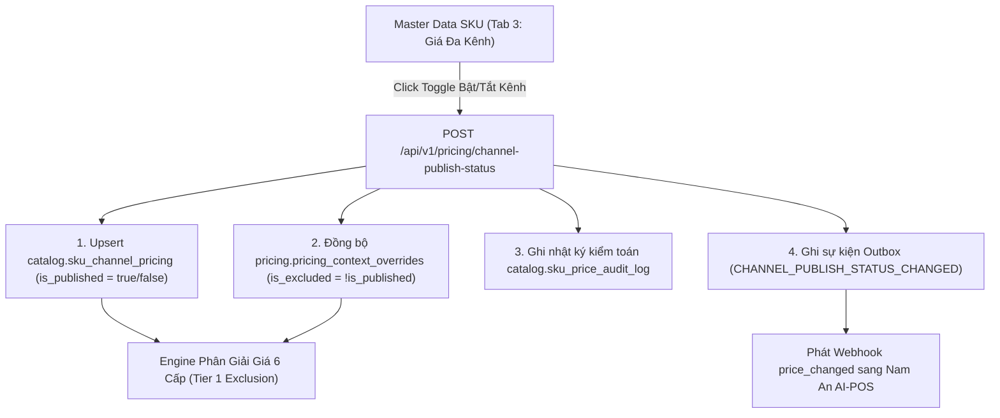

# 📘 TÀI LIỆU KỸ THUẬT TỔNG HỢP: QUẢN TRỊ KÊNH BÁN HÀNG, TÁCH BIỆT KHÁCH HÀNG & BẬT/TẮT BÁN SKU THEO KÊNH TẠI MASTER DATA

**Hệ thống:** Poppies ERP V2 $\longleftrightarrow$ Nam An AI-POS $\longleftrightarrow$ Kế toán Arito ERP  
**Phiên bản:** `2.1.0`  
**Cập nhật lần cuối:** `2026-11-04`  
**Trạng thái:** Đã triển khai Production (`https://poppies.namanmarket.com`)

---

## 1. Kiến Trúc Tách Biệt Kênh Bán Hàng (`channel_code`) & Khách Hàng (`customer_id`)

> [!IMPORTANT]
> **Nguyên tắc cốt lõi:** Kênh bán hàng (**Sales Channel**) và Khách hàng (**Customer**) là hai thực thể độc lập hoàn toàn. Kênh bán hàng quyết định **Bảng giá áp dụng, Biểu phí sàn, Mã kênh kế toán Arito (`ma_kenh`) và Quyền mở bán/ngưng bán SKU**; trong khi Khách hàng quyết định **Định danh người mua, Tích điểm CRM và Công nợ đối tác (`ma_kh`)**.

### 1.1. Bảng đối chiếu hai thực thể

| Tiêu chí | Kênh Bán Hàng (`Sales Channel`) | Khách Hàng (`Customer`) |
| :--- | :--- | :--- |
| **Định nghĩa** | Nơi phát sinh giao dịch hoặc nền tảng bán hàng (Tại quầy, Shopee, GrabMart, TikTok, Web, Zalo...). | Cá nhân hội viên mua hàng hoặc pháp nhân B2B / đối tác nhận hóa đơn. |
| **Trường định danh API** | `channel` / `channel_code` / `sales_channel_code` | `customer_id` / `customer_code` |
| **Ánh xạ Kế toán Arito** | Trường **`ma_kenh`** (`K21`, `K12`, `K15`, `K17`, `K10`, `K20`, `K22`) | Trường **`ma_kh`** (`KHLE`, SĐT hội viên, hoặc mã công nợ đối tác) |
| **Vai trò trong Định giá** | Quyết định **Bảng giá kênh (Tier 1 $\rightarrow$ Tier 3)**, chiết khấu sàn, phụ phí bao bì và trạng thái **Đang bán / Ngưng bán (`is_published`)**. | Quyết định **Hạng thẻ hội viên**, tích điểm thưởng (Loyalty) và chiết khấu VIP/B2B độc lập. |

### 1.2. Bảng Mã Kênh Chuẩn Hóa Toàn Hệ Thống (`CHANNEL_STANDARD_METADATA`)

| Tên kênh hiển thị | Mã Kênh AI-POS (`pos_channel_code`) | Mã Kênh Poppies (`channel_code`) | Mã Kênh Arito (`ma_kenh`) | Nhóm Kênh (`channel_group`) | Tích điểm CRM (`earn_enabled`) |
| :--- | :--- | :--- | :---: | :--- | :---: |
| **Tại cửa hàng** | `STORE` | `POS_OFFLINE` | `K21` | `store` | `true` |
| **Shopee** | `SHOPEE` | `SHOPEE` | `K12` | `marketplace` | `false` |
| **TikTok Shop** | `TIKTOK` | `TIKTOK_SHOP` | `K17` | `marketplace` | `false` |
| **Lazada** | `LAZADA` | `LAZADA` | `K10` | `marketplace` | `false` |
| **Grab Mart** | `GRAB` | `GRAB_MART` | `K15` | `delivery_app` | `false` |
| **ShopeeFood** | `SHOPEEFOOD` | `SHOPEE_FOOD` | `K22` | `delivery_app` | `false` |
| **Website** | `WEB` | `HARAVAN_WEB` | `K20` | `social_web` | `true` |
| **Zalo OA** | `ZALO` | `ZALO` | `K20` | `social_web` | `true` |
| **Facebook** | `FACEBOOK` | `FACEBOOK` | `K20` | `social_web` | `true` |
| **Hotline / SĐT** | `PHONE` | `PHONE` | `K20` | `social_web` | `true` |

---

## 2. Cơ Chế Bật / Tắt Bán Sản Phẩm Trên Kênh Chỉ Định Tại Master Data SKU

### 2.1. Luồng Thao Tác Trên Giao Diện (`Master Data SKU`)
1. Truy cập chi tiết sản phẩm tại: `https://poppies.namanmarket.com/master-data/<skuCode>`
2. Chọn Tab **`3. GIÁ ĐA KÊNH & CỬA HÀNG`** ([`OmniPricingTab.tsx`](file:///Users/pabi/Nam%20An%20Mobile/NamAnMarket/Poppies%20v2/Poppies%20v2/frontend/src/modules/MasterData/components/OmniPricingTab.tsx)).
3. Tại bảng **`2. Bảng Giá Trên Các Kênh Thương Mại Điện Tử & Delivery`**, cột **`Trạng Thái Bán Trên Kênh`** hiển thị nút gạt (**Toggle Switch**) trực tiếp cho từng kênh (`HARAVAN_WEB`, `SHOPEE`, `TIKTOK_SHOP`, `GRAB_MART`, `LAZADA`...):
   - 🟢 **Đang bán (`isPublished = true`)**: Cho phép bán sản phẩm trên kênh chỉ định theo giá hiệu lực của kênh.
   - ⚪ **Ngưng bán (`isPublished = false`)**: Khóa/chặn bán sản phẩm trên kênh chỉ định ngay lập tức mà không ảnh hưởng đến việc bán tại cửa hàng (`POS_OFFLINE`) hay các kênh khác.

### 2.2. Luồng Xử Lý Dữ Liệu Đồng Bộ 4 Tầng (Backend Engine)



Khi người dùng bật/tắt trạng thái kênh của 1 SKU tại Master Data, hàm [`PricingEngineService.toggle_publish_status`](file:///Users/pabi/Nam%20An%20Mobile/NamAnMarket/Poppies%20v2/Poppies%20v2/backend/app/services/pricing_service.py#L2612-L2750) thực thi nguyên tử (ACID):

1. **Cập nhật bảng `catalog.sku_channel_pricing`**:
   - Lưu `is_published = true` (Mở bán) hoặc `false` (Ngưng bán) cho cặp `(sku_id, channel_code)`.
2. **Đồng bộ tức thì vào bảng `pricing.pricing_context_overrides` (Tier 1 Exclusion)**:
   - Khi **Tắt bán (`is_published = false`)**: Tự động đánh dấu `is_excluded = true` cho `(sku, channel_code)`.
   - Khi **Bật bán (`is_published = true`)**: Tự động gỡ cờ chặn `is_excluded = false` cho `(sku, channel_code)`.
3. **Ghi nhận Audit Trail (`catalog.sku_price_audit_log`)**:
   - Lưu vết đầy đủ người thực hiện (`changed_by`), thời gian (`created_at`), kênh tác động (`target_code`) và lý do: *"Mở bán (ON) / Ngưng bán (OFF) sản phẩm trên kênh `<channel_code>` tại Master Data SKU"*.
4. **Phát tín hiệu Webhook sang AI-POS (`pricing.pricing_outbox_events`)**:
   - Tạo sự kiện `CHANNEL_PUBLISH_STATUS_CHANGED` để AI-POS làm mới cache của đúng SKU trên kênh đó.

---

## 3. Tác Động Lên Engine Phân Giải Giá & API Cổng AI-POS

### 3.1. Khi sản phẩm bị TẮT (`Ngưng bán`) trên 1 kênh chỉ định
Khi AI-POS hoặc sàn TMĐT gọi API lấy giá của SKU trên kênh đã bị tắt:
- **`POST /api/v1/pos/pricing/resolve`** hoặc **`GET /api/v1/pos/pricing/snapshots?channel=<CHANNEL>`**:
  - Engine dừng ngay tại **Tier 1 (`TIER_1_EXCLUDED`)** và trả về:
    ```json
    {
      "sku": "290031798000",
      "allowed_in_context": false,
      "allowedInContext": false,
      "is_listed": false,
      "effective_price": 0.0,
      "price_source": "excluded:GRAB_MART",
      "resolution_tier": "TIER_1_EXCLUDED",
      "reason": "Sản phẩm bị ngưng bán / chặn bán tại chi nhánh CH10001 / kênh GRAB_MART"
    }
    ```
  - Đồng thời các kênh khác (ví dụ `POS_OFFLINE`, `SHOPEE`) **vẫn mở bán bình thường** với `allowed_in_context: true`.

---

## 4. Hợp Đồng Giao Tiếp API Chuẩn (API Contracts)

### 4.1. API Bật / Tắt Trạng Thái Bán SKU Trên Kênh Chỉ Định
- **Endpoint:** `POST /api/v1/pricing/channel-publish-status`
- **Request Body:**
  ```json
  {
    "scopeType": "CHANNEL",
    "scopeCode": "GRAB_MART",
    "sku": "290031798000",
    "isPublished": false
  }
  ```
- **Response:**
  ```json
  {
    "success": true,
    "sku": "290031798000",
    "scopeType": "CHANNEL",
    "scopeCode": "GRAB_MART",
    "isPublished": false,
    "message": "Đã TẮT bán SKU 290031798000 trên GRAB_MART"
  }
  ```

### 4.2. API Danh Mục Kênh Bán Hàng (`GET /api/v1/pos/pricing/channels`)
- Trả về đầy đủ 10 kênh bán hàng tiêu chuẩn, kèm mã kênh POS và mã kênh kế toán Arito (`ma_kenh`), **tuyệt đối không chứa `customer_id`**:
  ```json
  {
    "success": true,
    "total": 10,
    "channels": [
      {
        "channel_code": "POS_OFFLINE",
        "pos_channel_code": "STORE",
        "arito_channel_code": "K21",
        "ma_kenh": "K21",
        "channel_group": "store",
        "earn_enabled": true,
        "channel_name": "Tại cửa hàng",
        "default_markup_percent": 0.0,
        "packaging_fee_vnd": 0.0,
        "is_dynamic": false,
        "is_active": true
      },
      {
        "channel_code": "SHOPEE",
        "pos_channel_code": "SHOPEE",
        "arito_channel_code": "K12",
        "ma_kenh": "K12",
        "channel_group": "marketplace",
        "earn_enabled": false,
        "channel_name": "Shopee Mall Nam An",
        "default_markup_percent": 20.0,
        "packaging_fee_vnd": 3000.0,
        "is_dynamic": true,
        "is_active": true
      }
    ]
  }
  ```

### 4.3. Webhook Thông Báo Biến Động Giá / Trạng Thái Kênh Sang AI-POS (`event_id` & Idempotency)
- **Endpoint đích tại AI-POS:** `POST /api/v1/pricing/webhook/price-changed`
- **Headers chống trùng & xác thực:**
  - `X-Poppies-Webhook-Key`: Secret token xác thực giữa Poppies và AI-POS
  - `X-Event-Id` / `Idempotency-Key`: Khóa định danh sự kiện duy nhất (`event_id`)
- **Payload chuẩn bắn từ `PricingOutboxDispatcher`:**
  ```json
  {
    "event_id": "evt_outbox_89412a87c3b1",
    "event": "price_changed",
    "event_type": "CHANNEL_PUBLISH_STATUS_CHANGED",
    "channel": "GRAB_MART",
    "channel_code": "GRAB_MART",
    "branch": "ALL",
    "branch_code": "ALL",
    "affected_skus": ["290031798000"],
    "is_full_catalog": false,
    "timestamp": "2026-11-04T02:25:00Z"
  }
  ```
- **Cơ chế đảm bảo an toàn dữ liệu:**
  1. **Chống xử lý trùng lặp (Idempotency):** `event_id` lấy trực tiếp từ khóa chính `pricing.pricing_outbox_events.event_id` (`str(outbox_record.event_id)`), giữ nguyên bất biến qua mọi lần retry.
  2. **Chống đè sự kiện ngược thứ tự (Out-of-Order Protection):** Trường `timestamp` giữ nguyên thời điểm gốc phát sinh sự kiện (`outbox_record.created_at.isoformat()`), không bị ghi đè bởi thời điểm retry.
  3. **Truy vết kiểm toán liên hệ thống (Cross-System Audit Trail):** `eventId` được trả về ngay trong response của API `POST /api/v1/pricing/channel-publish-status` và lưu trong bảng `pricing.pricing_outbox_events` để đối soát 1-1 với Redis/Log phía AI-POS.

---

## 5. Danh Sách Tập Tin Mã Nguồn Đã Cập Nhật

1. **Backend:**
   - [`Poppies v2/Poppies v2/backend/app/routers/pos_pricing.py`](file:///Users/pabi/Nam%20An%20Mobile/NamAnMarket/Poppies%20v2/Poppies%20v2/backend/app/routers/pos_pricing.py): Chuẩn hóa `CHANNEL_CODE_MAP`, `CHANNEL_STANDARD_METADATA` (10 kênh + mã Arito `K10`..`K22`), tách biệt hoàn toàn `customer_id` khỏi danh mục kênh.
   - [`Poppies v2/Poppies v2/backend/app/routers/pricing.py`](file:///Users/pabi/Nam%20An%20Mobile/NamAnMarket/Poppies%20v2/Poppies%20v2/backend/app/routers/pricing.py): Endpoint `POST /api/v1/pricing/channel-publish-status` và tách biệt `customer_id` trong `/resolve`.
   - [`Poppies v2/Poppies v2/backend/app/services/pricing_service.py`](file:///Users/pabi/Nam%20An%20Mobile/NamAnMarket/Poppies%20v2/Poppies%20v2/backend/app/services/pricing_service.py): Đồng bộ `toggle_publish_status` giữa `catalog.sku_channel_pricing`, `pricing.pricing_context_overrides`, `catalog.sku_price_audit_log` và Outbox Webhook; kiểm tra `is_published = false` tại Tier 1 của `resolve_price_context`.
2. **Frontend:**
   - [`Poppies v2/Poppies v2/frontend/src/modules/MasterData/components/OmniPricingTab.tsx`](file:///Users/pabi/Nam%20An%20Mobile/NamAnMarket/Poppies%20v2/Poppies%20v2/frontend/src/modules/MasterData/components/OmniPricingTab.tsx): Bổ sung nút gạt Bật/Tắt (`Đang bán` / `Ngưng bán`) trực tiếp trên từng dòng kênh bán hàng trong Master Data SKU.
   - [`Poppies v2/Poppies v2/frontend/src/modules/MasterData/api/masterDataApi.ts`](file:///Users/pabi/Nam%20An%20Mobile/NamAnMarket/Poppies%20v2/Poppies%20v2/frontend/src/modules/MasterData/api/masterDataApi.ts): Bổ sung client API `toggleChannelPublishStatusApi`.
   - [`Poppies v2/Poppies v2/frontend/src/modules/MasterData/components/EcommerceChannelFeeModal.tsx`](file:///Users/pabi/Nam%20An%20Mobile/NamAnMarket/Poppies%20v2/Poppies%20v2/frontend/src/modules/MasterData/components/EcommerceChannelFeeModal.tsx): Hiển thị chuẩn ánh xạ Mã Kênh POS & Mã Kênh Kế Toán Arito (`Sales Channel`), tách biệt hoàn toàn với Khách hàng.
