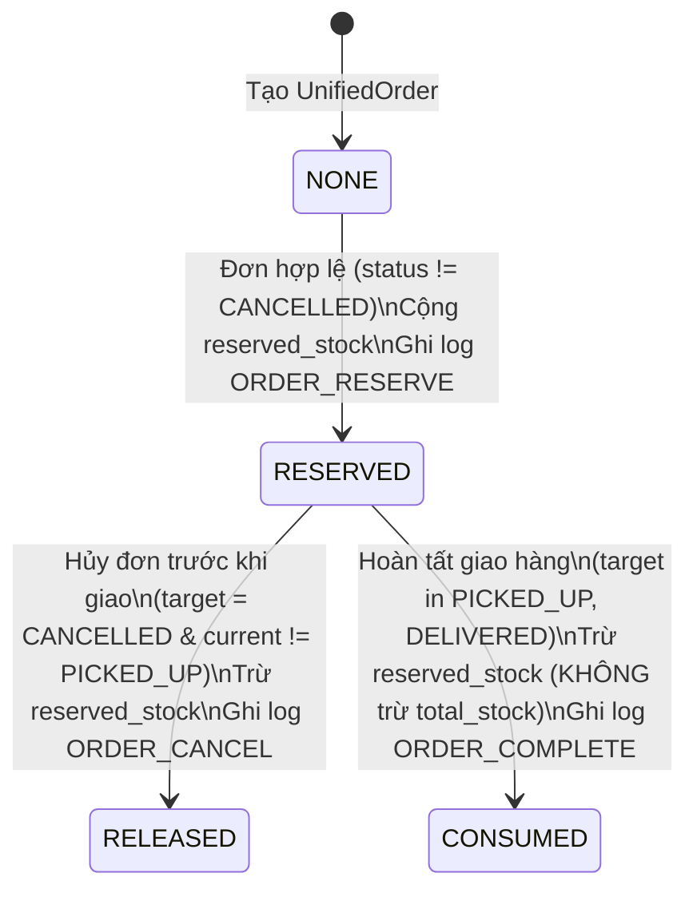

# Cơ Chế Trừ Tồn Ảo Khi Phát / Nhận Đơn (Virtual Stock Reservation)

Tài liệu này mô tả kiến trúc, máy trạng thái, công thức tính tồn kho khả dụng, cơ chế chống xung đột đồng thời (race condition / deadlock) và quy chuẩn vận hành – hiển thị của tính năng **Trừ tồn ảo (Virtual Stock Reservation)** trên **Nam An Unified Merchant Portal (NAM-UMP)**.

---

## 1. Mục tiêu & Nguyên tắc Nguồn sự thật duy nhất (Single Source of Truth)

Trong mô hình bán hàng đa kênh (ShopeeFood, GrabMart, ShopeeMart) kết nối với hệ thống **Poppies ERP POS (CTTK)**:

- **Poppies ERP POS (`cttk`) là Nguồn sự thật duy nhất (Single Source of Truth) cho tồn kho vật lý (`total_stock`)**. Khi đơn hàng hoàn tất giao và được hạch toán tại POS, tồn vật lý `total_stock` sẽ giảm tương ứng ở nguồn CTTK và được đồng bộ về Portal.
- **Nam An Merchant Portal** chỉ quản lý **tồn giữ chỗ ảo (`reserved_stock`)** trong khoảng thời gian đơn hàng đang được xử lý tại cửa hàng (từ lúc nhận đơn qua webhook cho đến khi tài xế nhận hàng hoặc đơn bị hủy).
- **Không trừ đúp (No Double-Deduction)**: Portal **tuyệt đối không tự ý trừ `total_stock`** khi đơn hàng chuyển sang trạng thái `PICKED_UP` hoặc `DELIVERED`. Portal chỉ giải phóng `reserved_stock` (chuyển `stock_reservation_status` sang `CONSUMED`), tránh tình trạng trừ 2 lần (1 lần trên Portal, 1 lần từ Poppies CTTK).

---

## 2. Công thức chuẩn hóa Tồn kho Khả dụng

Mọi điểm tính toán tồn kho trong hệ thống (nhận đơn, cập nhật trạng thái đơn, đồng bộ Poppies CTTK, cập nhật nhanh tồn kho, đẩy tồn lên sàn) đều sử dụng hàm chuẩn hóa duy nhất `InventoryService.compute_available_stock` tại `app/services/inventory_service.py`:

```python
available_stock = max(0.0, total_stock - reserved_stock - safety_stock)
```

Trong đó:
- `total_stock`: Tồn kho vật lý thực tế tại chi nhánh (đồng bộ từ Poppies ERP / CTTK).
- `reserved_stock`: Tổng số lượng đang được giữ chỗ cho các đơn hàng chưa hoàn tất/chưa hủy (`stock_reservation_status = "RESERVED"`).
- `safety_stock`: Tồn kho an toàn (mặc định `2.0` khi khởi tạo mới từ Poppies sync nếu chưa có cấu hình riêng).
- `available_stock`: Tồn kho khả dụng thực tế để bán và đồng bộ lên các sàn thương mại điện tử. Khi `available_stock <= 0.0`, cờ `is_out_of_stock` được bật (`True`).

---

## 3. Kiến trúc & Máy trạng thái (`stock_reservation_status`)

Trường `stock_reservation_status` trên bảng `unified_orders` (`app/models/order.py`, migration `a1b2c3d4e5f6_add_stock_reservation_status.py`) theo dõi vòng đời giữ tồn ảo của từng đơn hàng với giá trị mặc định `"NONE"`.



### Chi tiết các bước chuyển trạng thái

1. **Khi nhận đơn mới (`OrderService.create_or_get_inbound_order` — `app/services/order_service.py`)**:
   - Đơn mới được khởi tạo với `stock_reservation_status = "NONE"`.
   - Nếu `order.status != UnifiedOrderStatus.CANCELLED` và `(order.stock_reservation_status or "NONE") == "NONE"`:
     - Hệ thống gom nhóm số lượng theo SKU (`sku_qty_map`), bỏ qua SKU rỗng hoặc `"UNKNOWN"`.
     - Cộng `qty_needed` vào `StoreInventory.reserved_stock`.
     - Tính lại `available_stock` qua `InventoryService.compute_available_stock(...)` và cập nhật `is_out_of_stock = available_stock <= 0.0`.
     - Ghi nhận lịch sử biến động `InventoryStockLog` với `change_type = "ORDER_RESERVE"`.
     - Cập nhật `order.stock_reservation_status = "RESERVED"`.
   - Nếu có SKU chạm ngưỡng hết hàng (`is_out_of_stock == True`), sau khi commit giao dịch đơn hàng, hệ thống đẩy tín hiệu hết hàng (`available_stock = 0`, `is_out_of_stock = True`) sang các kênh đang liên kết của cửa hàng qua `channel_registry`.

2. **Khi đơn hàng chuyển sang `PICKED_UP` hoặc `DELIVERED` (`OrderService.update_order_status`)**:
   - Chỉ thực hiện nếu trạng thái trước đó chưa phải `PICKED_UP`, `DELIVERED`, `CANCELLED` và `order.stock_reservation_status == "RESERVED"`.
   - Giảm `reserved_stock = max(0.0, reserved_stock - qty_val)`, **giữ nguyên `total_stock`**.
   - Tính lại `available_stock` và `is_out_of_stock`.
   - Ghi `InventoryStockLog` với `change_type = "ORDER_COMPLETE"`.
   - Chuyển `order.stock_reservation_status = "CONSUMED"`.

3. **Khi đơn hàng bị hủy `CANCELLED` (`OrderService.update_order_status`)**:
   - Chỉ tự động hoàn tồn ảo nếu đơn **chưa được tài xế lấy (`current_status != UnifiedOrderStatus.PICKED_UP`)** và `order.stock_reservation_status == "RESERVED"`.
   - Giảm `reserved_stock = max(0.0, reserved_stock - qty_val)`, tính lại `available_stock` và `is_out_of_stock`.
   - Ghi `InventoryStockLog` với `change_type = "ORDER_CANCEL"`.
   - Chuyển `order.stock_reservation_status = "RELEASED"`.
   - Nếu việc hoàn tồn làm SKU chuyển từ hết hàng (`was_oos == True`) sang còn hàng (`not inv_obj.is_out_of_stock`), hệ thống tự động đẩy lại tồn khả dụng mới lên các kênh liên kết của cửa hàng.

4. **Khi đồng bộ từ Poppies ERP / CTTK (`app/services/poppies_service.py`)**:
   - Khi cập nhật `total_stock` mới cho `StoreInventory` đã tồn tại, hệ thống luôn tính lại `available_stock` bằng `InventoryService.compute_available_stock(new_total, store_inv.reserved_stock, store_inv.safety_stock)`, bảo toàn lượng `reserved_stock` đang giữ cho các đơn đang xử lý.

---

## 4. Cơ chế chống Race Condition & Deadlock

Để đảm bảo an toàn dữ liệu khi nhiều webhook hoặc thao tác cập nhật trạng thái xảy ra đồng thời:

1. **Chống tạo trùng đơn & trừ tồn 2 lần (`IntegrityError` trên `ix_channel_order_unique`)**:
   - Bảng `unified_orders` có unique index `ix_channel_order_unique` trên cặp `(channel_id, channel_order_id)`.
   - Nếu hai request webhook của cùng một đơn đến cùng lúc và vượt qua bước kiểm tra ban đầu, database sẽ ném `IntegrityError`.
   - `OrderService.create_or_get_inbound_order` bắt `IntegrityError`, thực hiện `await db.rollback()`, truy vấn lại đơn đã tồn tại và trả về `(dup_order, False)` (idempotent), không trừ tồn lần thứ hai.

2. **Khóa dòng `StoreInventory` theo thứ tự từ điển SKU (Deadlock Prevention)**:
   - Phương thức `OrderService._lock_inventories_sorted(store_id, sorted_skus, db)` sắp xếp danh sách SKU tăng dần (`sorted(sku_qty_map.keys())`) và truy vấn khóa bi quan:
     ```python
     select(StoreInventory)
     .where(
         StoreInventory.store_id == store_id,
         StoreInventory.sku.in_(sorted_skus),
     )
     .order_by(StoreInventory.sku.asc())
     .with_for_update()
     ```
   - Việc mọi transaction đều khóa các dòng `StoreInventory` theo cùng một thứ tự `sku ASC` loại bỏ hoàn toàn nguy cơ deadlock chéo (AB-BA lock ordering) khi hai đơn hàng có chung nhiều SKU được xử lý song song.

3. **Khóa dòng `UnifiedOrder` khi cập nhật trạng thái**:
   - Trong `OrderService.update_order_status`, bản ghi `UnifiedOrder` được truy vấn kèm `.with_for_update()` trước khi kiểm tra `VALID_STATUS_TRANSITIONS` và `stock_reservation_status`, đảm bảo hai request chuyển trạng thái đồng thời trên cùng một đơn được tuần tự hóa (serialize), không thể vừa `CONSUMED` vừa `RELEASED`.

---

## 5. Chính sách xử lý khi thiếu tồn ảo (`VIRTUAL_STOCK_STRICT_MODE`)

Cấu hình `VIRTUAL_STOCK_STRICT_MODE` nằm trong `app/core/config.py` (mặc định `False`):

- **Chế độ mặc định (`VIRTUAL_STOCK_STRICT_MODE = False`)**:
  - Không chặn đơn hàng đến từ sàn (tránh rớt đơn / phạt SLA từ ShopeeFood, GrabMart, ShopeeMart) khi thiếu bản ghi `StoreInventory` hoặc `available_stock < qty_needed`.
  - Hệ thống vẫn tiếp tục tạo đơn, ghi nhận cảnh báo vào `OperationalErrorLog` (sau khi transaction đơn hàng đã commit để không làm rollback đơn) với mã:
    - `MISSING_STORE_INVENTORY`: Không tìm thấy dòng tồn kho của SKU tại cửa hàng.
    - `INSUFFICIENT_VIRTUAL_STOCK`: `available_stock` trước khi giữ chỗ nhỏ hơn số lượng đặt.
  - Nếu sau khi giữ chỗ `available_stock <= 0.0`, hệ thống đẩy trạng thái hết hàng (`available_stock = 0`) lên các sàn để ngăn phát sinh thêm đơn oversell.

- **Chế độ nghiêm ngặt (`VIRTUAL_STOCK_STRICT_MODE = True`)**:
  - Khi thiếu `StoreInventory` hoặc `available_stock < qty_needed`, hệ thống thực hiện `await db.rollback()` và ném `ValidationError` để từ chối nhận đơn.

---

## 6. Quy chuẩn hiển thị trên Giao diện Kho (`inventory.html`)

Trên trang Quản lý Kho (`app/templates/inventory.html`), cột tồn kho hiển thị theo định dạng chuẩn:

- **Định dạng chính**: `{total_stock}-{reserved_stock}` (ví dụ: `11-3`, nghĩa là tồn vật lý từ POS là `11`, đang giữ chỗ ảo cho đơn hàng là `3`).
- **Tooltip chi tiết**: Hiển thị đầy đủ 4 thành phần: `Thực tế: {total_stock} | Giữ chỗ: {reserved_stock} | An toàn: {safety_stock} | Khả dụng: {available_stock}`.
- **Dòng phụ bên dưới**: Hiển thị `Khả dụng: {available_stock}` (và `• AT: {safety_stock}` nếu `safety_stock > 0`), giúp nhân viên vận hành phân biệt rõ tồn vật lý tại quầy và tồn khả dụng thực tế đang bán trên sàn.
